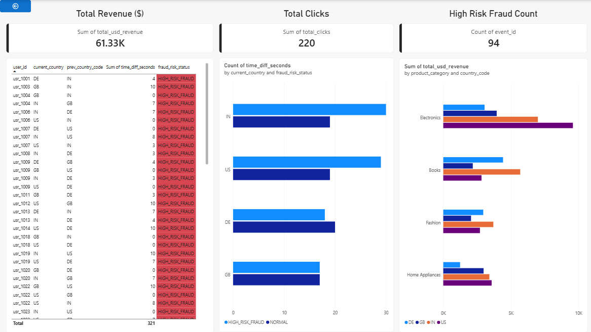

# Enterprise Cross-Border E-Commerce Fraud & FinOps Analytics Platform

[](https://fabric.microsoft.com/)
[](https://azure.microsoft.com/)
[](https://spark.apache.org/)
[](https://learn.microsoft.com/en-us/sql/t-sql/)
[](https://gdpr.eu/)

An end-to-end, enterprise-grade cloud data engineering and analytical framework engineered on **Microsoft Fabric** and **Azure ADLS Gen2**. This solution ingests high-velocity multi-country clickstream data, normalizes cross-currency financial metrics, enforces strict GDPR/CCPA PII masking via **SHA-256**, detects **Velocity Fraud (impossible geographical travel under 10 seconds)** using advanced T-SQL windowing functions, and automates continuous pipeline orchestration using **Fabric Data Factory**.

---

## 📐 Enterprise Architecture Overview

The platform adopts a modernized **Medallion Architecture (Bronze $\rightarrow$ Silver $\rightarrow$ Gold)** with Zero-Copy shortcuts linking Azure Cloud Infrastructure directly into Microsoft Fabric OneLake.

```
+-----------------------------------------------------------------------------------+
|                              INGESTION LAYER (BRONZE)                             |
|                                                                                   |
|  [ Python Synthetic Clickstream Data Generator ]                                  |
|         |                                                                         |
|         v                                                                         |
|  [ Azure Data Lake Storage Gen2 (ADLS Gen2) ]  <--- Secrets Secured via           |
|  (Container: raw-clickstream)                        Azure Key Vault              |
|         |                                                                         |
|         v (Zero-Copy Linking via OneLake Shortcut)                                |
|  [ Fabric Lakehouse: lh_ecommerce_bronze / Files ]                                |
+------------------------------------------+----------------------------------------+
                                           |
                                           v
+-----------------------------------------------------------------------------------+
|                             PROCESSING LAYER (SILVER)                             |
|                                                                                   |
|  [ Fabric Synapse PySpark Engine (nb_silver_transformations) ]                   |
|     ├── Currency Normalization (INR/GBP/EUR -> USD via Exchange Rates)            |
|     ├── Timestamp Standardization (ISO 8601 -> UTC)                               |
|     ├── SHA-256 PII Hashing (Email, IP Address)                                   |
|     └── Delta Parquet Optimizations (OPTIMIZE + Z-ORDER by user_id, country_code)  |
|         |                                                                         |
|         v                                                                         |
|  [ Silver Delta Table: silver_global_clicks ]                                     |
+------------------------------------------+----------------------------------------+
                                           |
                                           v
+-----------------------------------------------------------------------------------+
|                              ANALYTICS LAYER (GOLD)                               |
|                                                                                   |
|  [ Fabric SQL Analytics Endpoint Engine ]                                         |
|     ├── vw_velocity_fraud_alerts (LAG Windowing, Time-Delta Calculation <= 10s)    |
|     └── vw_revenue_summary_by_country (Aggregated FinOps & Revenue Metrics)      |
+------------------------------------------+----------------------------------------+
                                           |
                                           v
+-----------------------------------------------------------------------------------+
|                            ORCHESTRATION & MAINTENANCE                            |
|                                                                                   |
|  [ Fabric Data Factory Pipeline (pl_ecommerce_clickstream_orchestration) ]        |
|     └── Sequential Execution: Ingestion -> Silver Compute -> Maintenance Vacuum    |
+-----------------------------------------------------------------------------------+
```

---

## 🛠️ Tech Stack & Engineering Specifications

| Layer / Functional Domain | Technologies & Frameworks Applied | Key Technical Deliverables |
| :--- | :--- | :--- |
| **Cloud Infrastructure** | Azure Blob Storage (ADLS Gen2), Azure Key Vault | Hierarchical Namespace, Role-Based Access Control, Secret Management |
| **Data Ingestion & Ingress** | Python 3.10+, Azure SDK (`azure-storage-filedatalake`), Faker | Multi-threaded synthetic stream ingestion, intentional fraud pattern injection |
| **Data Lake Engine** | Microsoft Fabric OneLake, OneLake Shortcuts | Zero-Copy architecture eliminating ETL egress costs |
| **Batch Transformation** | PySpark 3.4+, Synapse Compute Engine, Delta Lake | Currency Standardization, ISO 8601 UTC Conversion, Delta schema enforcement |
| **Security & Governance** | Cryptographic Hashing (`sha2`), GDPR Compliance | Column-level PII masking for `user_email` and `ip_address` |
| **Analytical Engine** | Fabric SQL Analytics Endpoint, Advanced T-SQL | Analytical Window Functions (`LAG`), Spatial-Temporal Velocity Fraud Detection |
| **Optimization & Storage** | Delta Lake Storage, Z-Ordering, VACUUM | File compaction on `(user_id, country_code)`, stale transaction cleanup (168 hrs) |
| **Orchestration** | Fabric Data Factory Pipelines | Dynamic trigger scheduling, activity retry controls, state tracking |

---

## ⚙️ Data Pipeline Implementation Details

### Phase 1: Ingestion & Infrastructure Setup
1. **Azure Resource Provisioning**: Provisioned Resource Group `rg-ecommerce-fabric-prod`, Azure Data Lake Storage Gen2 `stecommerceclickstream` with Hierarchical Namespace enabled, and Azure Key Vault `kv-ecommerce-secrets`.
2. **Key Vault Configuration**: Injected sensitive access tokens (`StorageAccountKey`) and cryptographic salting strings (`PIISaltKey`) into Key Vault secrets to enforce zero-hardcoded-credentials principles.

### Phase 2: Synthetic Data Engine & OneLake Integration
1. **Clickstream Generator**: Engineered a Python ingestion script utilizing `azure-storage-filedatalake` to push JSON batches directly into the `raw-clickstream` container.
2. **Fraud Simulation**: Engineered artificial bot behavior patterns—specifically injecting multi-country requests from identical `user_id` values (`usr_fraud_999`) within a 3-second window.
3. **OneLake Ingestion**: Established an Azure ADLS Gen2 **OneLake Shortcut** inside Microsoft Fabric (`lh_ecommerce_bronze`), granting native analytical access without copying underlying storage bytes.

### Phase 3: Silver Layer Processing & PII Masking
Data transformation logic is implemented in `nb_silver_transformations` using PySpark:
* **Currency Normalization**: Dynamic conversion of local transaction prices (`INR`, `GBP`, `EUR`) to standard base currency (`USD`).
* **GDPR Compliance**: Cryptographic SHA-256 irreversible hashing applied to personal identifiers (`user_email`, `ip_address`). Raw identifier columns are explicitly purged.
* **Storage Optimization**: Transformed records written to Delta Parquet format (`silver_global_clicks`), optimized with `ZORDER` on primary lookup dimensions: `user_id` and `country_code`.

#### PySpark Transformation snippet:
```python
# Extract and normalize timestamps & financial attributes
df_normalized = df_raw.withColumn(
    "usd_price",
    col("local_price") / 
    when(col("local_currency") == "INR", 83.0)
    .when(col("local_currency") == "GBP", 0.79)
    .when(col("local_currency") == "EUR", 0.92)
    .otherwise(1.0)
)

# Apply SHA-256 cryptographic security to raw PII attributes
df_secured = df_normalized \
    .withColumn("event_timestamp_utc", to_utc_timestamp(col("event_timestamp"), "UTC")) \
    .withColumn("masked_user_email", sha2(col("user_email"), 256)) \
    .withColumn("masked_ip_address", sha2(col("ip_address"), 256)) \
    .drop("user_email", "ip_address", "local_price", "local_currency") \
    .dropDuplicates(["event_id"])
```

---

## 🔍 Fraud Detection & Analytics Engine (Gold Layer)

Using the **Fabric SQL Analytics Endpoint**, Analytical T-SQL views were constructed over the Silver Delta Lake tables to compute velocity metrics and revenue aggregation.

### 1. Velocity Fraud Detection View (`vw_velocity_fraud_alerts`)
Detects impossible travel velocity where a single user initiates transactions from distinct geographical locations within a **$\le$ 10-second threshold**:

```sql
CREATE VIEW vw_velocity_fraud_alerts AS
WITH ClickWindow AS (
    SELECT 
        event_id,
        user_id,
        session_id,
        country_code,
        device_type,
        product_category,
        usd_price,
        event_timestamp_utc,
        masked_ip_address,
        LAG(event_timestamp_utc, 1) OVER (
            PARTITION BY user_id 
            ORDER BY event_timestamp_utc
        ) AS prev_event_timestamp,
        LAG(country_code, 1) OVER (
            PARTITION BY user_id 
            ORDER BY event_timestamp_utc
        ) AS prev_country_code
    FROM dbo.silver_global_clicks
)
SELECT 
    event_id,
    user_id,
    session_id,
    country_code AS current_country,
    prev_country_code,
    event_timestamp_utc,
    prev_event_timestamp,
    DATEDIFF(second, prev_event_timestamp, event_timestamp_utc) AS time_diff_seconds,
    masked_ip_address,
    product_category,
    usd_price,
    CASE 
        WHEN prev_country_code IS NOT NULL 
             AND country_code <> prev_country_code 
             AND DATEDIFF(second, prev_event_timestamp, event_timestamp_utc) <= 10 
        THEN 'HIGH_RISK_FRAUD'
        ELSE 'NORMAL'
    END AS fraud_risk_status
FROM ClickWindow;
```

### 2. FinOps Revenue Aggregation View (`vw_revenue_summary_by_country`)
Provides continuous visibility into regional order metrics and standardized revenue figures:

```sql
CREATE VIEW vw_revenue_summary_by_country AS
SELECT 
    country_code,
    product_category,
    COUNT(event_id) AS total_clicks,
    SUM(usd_price) AS total_usd_revenue,
    AVG(usd_price) AS average_usd_order_value
FROM dbo.silver_global_clicks
GROUP BY country_code, product_category;
```
---

## 📊 Live Executive Power BI Dashboard (Direct Lake Mode)



The analytical views created in the Gold layer are connected directly to **Power BI via Direct Lake Mode** (Zero-Copy architecture, eliminating import schedules). This executive-level dashboard surfaces real-time cross-border clickstream performance, regional revenue metrics, and velocity fraud alerts:

- **Total Revenue Tracking:** Real-time USD normalized revenue aggregation ($61.33K+).
- **Velocity Fraud Alerts:** Instant visualization of high-risk suspicious anomalies (impossible travel under 10 seconds) highlighted via dynamic red status conditional formatting.
- **FinOps & Regional Distribution:** Granular breakdown of total event clicks and average order values across product categories and country codes (US, IN, GB, DE).

---

## 📈 Execution Proof & System Performance

### 1. Velocity Fraud Engine Validation
Querying `vw_velocity_fraud_alerts` accurately identified bot activity from `usr_fraud_999` hopping between **US** and **IN** locations within 1-3 seconds:

| event_id | user_id | current_country | prev_country_code | event_timestamp_utc | prev_event_timestamp | time_diff_seconds | fraud_risk_status |
| :--- | :--- | :--- | :--- | :--- | :--- | :--- | :--- |
| `a08da6d5...` | `usr_fraud_999` | `IN` | `US` | `2026-10-22 12:57:40` | `2026-10-22 12:57:37` | `3` | `HIGH_RISK_FRAUD` |
| `4de68706...` | `usr_fraud_999` | `US` | `IN` | `2026-10-22 12:57:41` | `2026-10-22 12:57:40` | `1` | `HIGH_RISK_FRAUD` |
| `9d2603b1...` | `usr_fraud_999` | `IN` | `US` | `2026-10-22 12:57:43` | `2026-10-22 12:57:41` | `2` | `HIGH_RISK_FRAUD` |
| `741ed730...` | `usr_fraud_999` | `US` | `IN` | `2026-10-22 12:57:44` | `2026-10-22 12:57:43` | `1` | `HIGH_RISK_FRAUD` |

### 2. Global FinOps Aggregations
Query execution output from `vw_revenue_summary_by_country` demonstrating real-time currency conversion and aggregation across standard verticals:

| country_code | product_category | total_clicks | total_usd_revenue | average_usd_order_value |
| :--- | :--- | :--- | :--- | :--- |
| **IN** | Fashion | 9 | $1,937.62 | $215.29 |
| **DE** | Home Appliances | 3 | $723.42 | $241.14 |
| **US** | Electronics | 16 | $6,329.05 | $395.56 |
| **IN** | Books | 11 | $2,944.56 | $267.68 |
| **GB** | Electronics | 10 | $2,136.05 | $213.60 |

### 3. Automated Data Pipeline Orchestration
The pipeline `pl_ecommerce_clickstream_orchestration` executes the processing and maintenance notebooks sequentially with status monitoring and run verification:

* **Notebook1 (`nb_silver_transformations`)**: Status: `Succeeded` | Duration: `50s`
* **Wait1**: Status: `Succeeded` | Duration: `31s`
* **Notebook2 (`nb_delta_maintenance`)**: Status: `Succeeded` | Duration: `51s`

---

## 🧹 Storage Maintenance & Delta Lake Optimization

To minimize OneLake storage overhead and optimize analytical query speeds over long runs, maintenance tasks are implemented via `nb_delta_maintenance`:

```python
# Compaction and Z-Ordering via ABFS path
spark.sql("OPTIMIZE 'abfss://Ecommerce_Clickstream_Analytics@onelake.dfs.fabric.microsoft.com/lh_ecommerce_bronze.Lakehouse/Tables/silver_global_clicks' ZORDER BY (user_id, country_code)")

# Purge historic Delta log tombstones older than 7 days (168 hours)
spark.sql("VACUUM 'abfss://Ecommerce_Clickstream_Analytics@onelake.dfs.fabric.microsoft.com/lh_ecommerce_bronze.Lakehouse/Tables/silver_global_clicks' RETAIN 168 HOURS")
```

---

## 🚀 Deployment & Local Execution Guide

### Prerequisites
* Microsoft Fabric Workspace with Trial or Capacity License enabled.
* Azure Subscription with Access to ADLS Gen2 & Key Vault services.
* Python 3.10 installed locally or inside an Azure VM.

### Setup Instructions
1. **Clone the Repository**:
1. Clone the Repository:

   ```bash
   git clone [https://github.com/Tooba-Analytics/ecommerce-clickstream-pipeline-fabric.git](https://github.com/Tooba-Analytics/ecommerce-clickstream-pipeline-fabric.git)
   ```

2. **Configure Azure Key Vault & Storage**:
   * Deploy ADLS Gen2 Container `raw-clickstream`.
   * Store `StorageAccountKey` inside Azure Key Vault `kv-ecommerce-secrets`.

3. **Deploy Python Generator**:
   ```bash
   pip install azure-storage-filedatalake faker pandas
   export AZURE_STORAGE_ACCOUNT_KEY="<your-access-key>"
   python generate_clickstream.py
   ```

4. **Import Fabric Artifacts**:
   * Attach OneLake Shortcut `raw_clickstream_shortcut` under `lh_ecommerce_bronze/Files`.
   * Upload and run `nb_silver_transformations.ipynb` inside your Microsoft Fabric Workspace.
   * Execute `fraud_detection.sql` within the SQL Analytics Endpoint interface to build analytical views.
   * Publish pipeline `pl_ecommerce_clickstream_orchestration` via Data Factory and apply trigger schedule.

---

## 🔐 Security & Governance Principles Applied

* **Zero Plaintext Credentials**: All platform authentication protocols route strictly through environment variables or Azure Key Vault secrets.
* **Immutable Compliance**: Personal Identifiable Information (PII) is cryptographically isolated before persisting to disk.
* **Storage Optimization**: Automatic Delta table compaction reduces overhead from tiny-file problems inherent in high-velocity streaming workloads.
